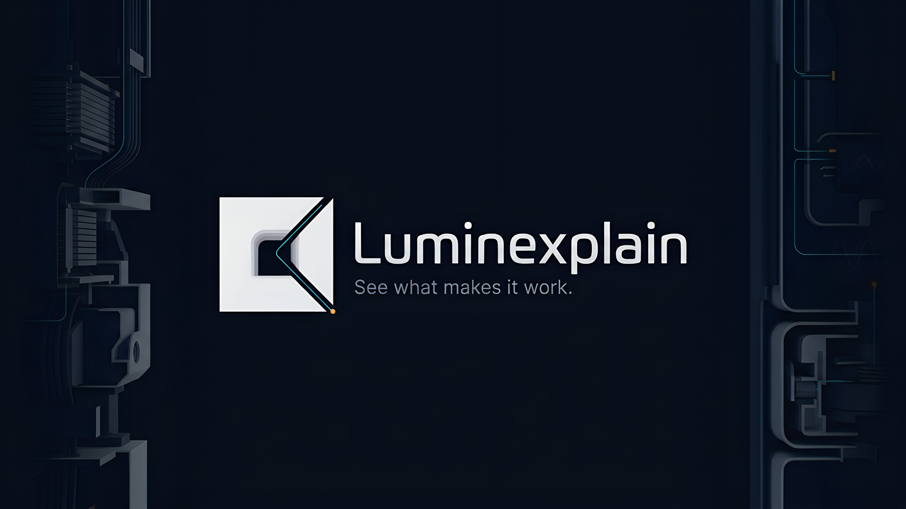

# Luminexplain

<p align="center">
  
</p>

Luminexplain is a YouTube explainer channel about the invisible processes inside everyday things. Every video is built in code with [Remotion](https://www.remotion.dev/) (React + TypeScript): animated systems, cutaways and step-by-step diagrams, with narration, sound design and captions timed frame by frame.

This repository is the whole production pipeline: the research behind each video, the scripts and storyboards, the narration and sound, the Remotion scenes that render the final cuts, and the thumbnails and upload packages.

## Episodes

| Episode | Long-form | Shorts |
|---|---|---|
| 001: Microwaves | *How a Microwave Actually Heats Food — and the Melted Candy Bar Behind It* (`Episode001Long`) | HowMicrowavesWork, CandyBarDiscovery, MicrowaveSafeDishes, StandingTime, SuperheatedWater |
| 002: Submarines | *The Hidden Machines That Keep a Submarine Crew Alive* (`Episode002Long`) | SubmarineOtherGas, SubmarineNoGPS, SubmarineMessages, SubmarineOxygen, SubmarinePressureHull, SubmarineStealth, SubmarineEnduranceLimits |

## How a video gets made

1. **Research:** every factual claim is checked against a source and logged in `research/<episode>/claims.md`. The script may only use verified claims.
2. **Script and storyboard:** `episodes/<episode>/<version>/` holds the script, a shot-by-shot storyboard (Markdown + JSON) and the shot timings.
3. **Narration:** generated locally with Kokoro-82M (voice `af_heart`) by the scripts in `scripts/audio/`. Each take is measured, and the approved take is recorded in a `manifest.json` that the scenes read.
4. **Sound design:** CC0 Foley from Freesound plus synthesized effects, placed on frame-accurate cues and logged in `audio-credits.md`.
5. **Animation:** scenes in `src/scenes/` are built from the reusable components in `src/components/` and driven only by `useCurrentFrame()`, `interpolate` and `spring`.
6. **Captions:** burned-in captions for Shorts, plus `.srt` files aligned to the narration.
7. **Thumbnails and publishing:** thumbnails and Shorts covers are Remotion stills. `publication/` has a step-by-step upload package (title, description, tags, chapters, subtitles) for YouTube, Instagram Reels and TikTok.

## Getting started

Requires Node.js `^20.19.0 || ^22.13.0 || >=24`. Previewing and rendering need no API keys or environment variables.

```console
npm ci
npm run dev        # Remotion Studio with every episode, Short and thumbnail
npm run lint       # ESLint + tsc
```

Renders go under `renders/episode-NNN/`, with a new folder for each version (the folder is git-ignored):

```console
npx remotion render Episode002Long renders/episode-002/Long/<version>/Episode002Long.mp4
npx remotion render Ep002Short-SubmarineNoGPS renders/episode-002/Shorts/SubmarineNoGPS/<version>/SubmarineNoGPS.mp4
npx remotion still E002LongThumbnail thumbnails/episode-002/Long/<version>/thumbnail.png
```

Add `--scale=0.5` for a quick preview render. Regenerating narration or sound effects is optional and needs Python 3, ffmpeg and a Kokoro venv at `~/.luminexplain-kokoro/` (see the docstring at the top of each script in `scripts/audio/`).

## Repository layout

| Path | Contents |
|---|---|
| `src/index.ts` → `src/Root.tsx` | The single entry point; `remotion.config.ts` is the only config |
| `src/components/` | Reusable visuals: `StepDiagram`, `ComponentCutaway`, `SignalPath`, `CameraFrame`, `Captions`, `AudioCue` and more (see `docs/component-inventory.md`) |
| `src/animations/`, `src/styles/` | Timing/easing helpers and theme tokens |
| `src/compositions/`, `src/scenes/`, `src/data/` | Per-episode compositions, scenes and typed data |
| `episodes/` | Scripts, storyboards, captions, narration and sound for each episode version |
| `research/` | Sources and verified claims |
| `scripts/audio/` | Narration, sound-effect and caption build scripts |
| `docs/` | Project brief, visual style, component inventory, production workflow |
| `thumbnails/`, `publication/` | Thumbnail stills and upload packages |
| `Assets/` | Channel banner, logo and watermark |

`CLAUDE.md` holds the working rules for this repository.

## Licences

The Luminexplain code, scripts, artwork and audio are © Luminexplain, all rights reserved. Third-party material:

- **Sound effects:** Freesound recordings under CC0, credited in `episodes/episode-001/*/audio-credits.md`
- **Narration model:** [Kokoro-82M](https://huggingface.co/hexgrad/Kokoro-82M) (Apache-2.0)
- **Claude Code skills** in `.agents/skills/`: unmodified copies from [VoiceStudio](https://github.com/debpalash/VoiceStudio), AGPL-3.0
- **Remotion:** [Remotion licence](https://github.com/remotion-dev/remotion/blob/main/LICENSE.md) (some companies need a company licence)
